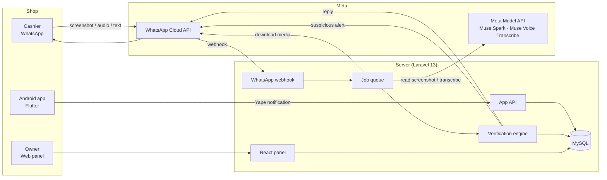

# PayGuard

WhatsApp assistant that verifies Yape payments for small businesses. A cashier forwards the customer's payment screenshot (or a voice note) and gets back **real** or **doesn't match** in seconds.

> Demo video: [VIDEO_URL — coming in Sprint 8]

Built from scratch for the **Meta Global AI Developer Hackathon** (Oct 26 – Nov 4, 2026), Indie Developer track.

## The problem

Small shops in Peru (corner stores, restaurants, market stalls) take payments with Yape, a digital wallet. The customer "proves" the payment by showing a **screenshot** — and fake or edited screenshots are a very common scam. The shop hands over the goods and the money never arrived.

The cashier can't check the owner's phone on every sale, and Yape has **no public API** to verify payments. The only real proof is the **notification** that arrives on the business phone.

## How it works

1. The **Android companion app**, installed on the business phone, reads every Yape notification and sends it to the server: wallet, amount, payer name, security code and time.
2. The customer pays and shows their screenshot to the cashier.
3. The cashier **forwards the screenshot** to PayGuard on WhatsApp — or sends a voice note ("did a 50 soles Yape from Juan arrive?").
4. **Muse Spark** reads the screenshot (or the transcribed query) and returns structured data.
5. PayGuard **matches it against the real received notification**: security code must match when both sides have it, same amount, close time (±10 min default), recipient equal to the business Yape holder, and one real payment validates only one screenshot.
6. The cashier gets a short reply in Spanish: ✅ verified, ⏳ not arrived yet (auto-rechecked for 2 minutes), or ❌ doesn't match, with the reason. Suspicious cases also alert the owner.

**Key rule:** the final verdict comes from matching the **real payment data**, never from the model's opinion of the image alone. AI reads and interprets; verification is data.

## Architecture



## Meta models used

| Model | Used for |
|---|---|
| **Muse Spark** (Meta Model API) | Reading payment screenshots into fixed-schema JSON, spotting edit signals, parsing text/audio payment queries |
| **Muse Voice Transcribe** (Meta Model API) | Transcribing cashier voice notes via `POST /v1/asr/transcribe` |
| **Muse Code** | The coding agent used to build this project |

## Stack

| Part | Technology |
|---|---|
| Backend + API | Laravel 13 (PHP 8.3), Sanctum |
| Web panel | React 19 + Tailwind 4 (Vite), same app |
| Database | MySQL 8 · Queue: database driver + Supervisor |
| Mobile app | Flutter (Android only), in `mobile/` |
| WhatsApp | Official WhatsApp Cloud API (webhook) |
| AI | Meta Model API (`https://api.meta.ai/v1`, OpenAI-compatible SDK) |

## Local setup

Requirements: PHP 8.3, Composer, MySQL 8, Node 20+, `ffmpeg` (for voice notes).

```bash
composer setup          # install, key, migrate, build panel
php artisan queue:work  # background jobs (downloads, AI, replies)
php artisan serve       # panel at http://localhost:8000/app
```

Android app:

```bash
cd mobile
flutter pub get
flutter run             # or: flutter build apk --release
```

See [docs/mobile.md](docs/mobile.md) for the APK, permissions and the local-testing server address.

## Environment variables

Copy `.env.example` to `.env`. Secrets stay out of git.

```bash
# Meta Model API
META_MODEL_API_KEY=
META_MODEL_BASE_URL=https://api.meta.ai/v1
META_MODEL_VISION=muse-spark-1.3
META_MODEL_TRANSCRIBE=muse-voice-transcribe-1.0

# WhatsApp Cloud API
WHATSAPP_TOKEN=
WHATSAPP_PHONE_NUMBER_ID=
WHATSAPP_APP_SECRET=
WHATSAPP_VERIFY_TOKEN=
WHATSAPP_ALERT_TEMPLATE=alerta_pago_sospechoso

# Registration protection (Cloudflare Turnstile)
TURNSTILE_SITE_KEY=
TURNSTILE_SECRET_KEY=

# Tuning (all optional, defaults work)
PAYGUARD_MATCH_WINDOW_MINUTES=10
PAYGUARD_RECHECK_MINUTES=2
PAYGUARD_QUERY_WINDOW_MINUTES=10
PAYGUARD_DEVICE_OFFLINE_MINUTES=10
```

## Project layout

```text
app/Services/Meta/         # Muse Spark + Voice Transcribe clients
app/Services/Verification/ # matcher, duplicates, cashier replies
app/Services/WhatsApp/     # Cloud API client, signature, media, alerts
app/Jobs/                  # queued message processing
resources/js/              # React panel (Spanish UI)
mobile/                    # Flutter Android app (Spanish UI)
docs/                      # specs in Spanish: PRD, plan, database, architecture
```

Full specs (in Spanish): [docs/PRD.md](docs/PRD.md) · [docs/arquitectura.md](docs/arquitectura.md) · [docs/base-de-datos.md](docs/base-de-datos.md) · [docs/plan-de-trabajo.md](docs/plan-de-trabajo.md) · [docs/mobile.md](docs/mobile.md)

## Known limitations

- Yape only; Plin is prepared in the data model but not enabled.
- Android only (iOS cannot read other apps' notifications).
- The business phone must be online; otherwise verifications answer "phone disconnected".
- Release APK currently signs with debug keys (see [docs/mobile.md](docs/mobile.md)).
- One WhatsApp number serves all businesses in this version (cashiers are routed by phone number).

## License

MIT — see [LICENSE](LICENSE).
