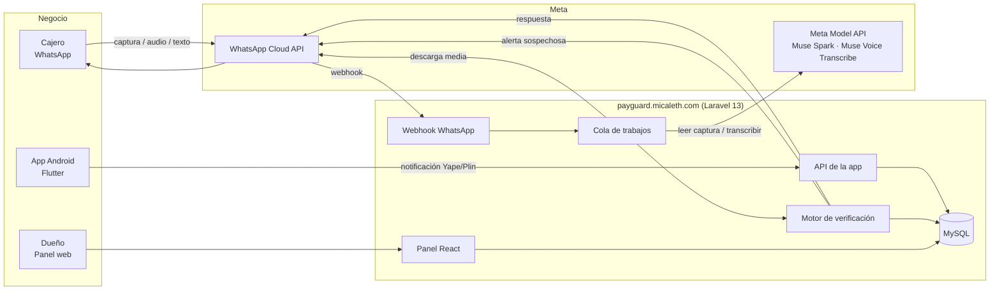

# PayGuard — Arquitectura

## Vista general



## Flujo de una consulta

1. WhatsApp envía el mensaje al **webhook** (`POST /webhooks/whatsapp`).
2. El webhook **verifica la firma** (`X-Hub-Signature-256`), ignora mensajes repetidos (`wa_message_id`), crea la verificación en `processing` y **responde 200 de inmediato**. Todo lo pesado va a la cola. Los avisos de estado (`statuses`: sent, delivered, read, failed) actualizan la entrega de las alertas al dueño por el `wa_message_id` del mensaje enviado.
3. El trabajo en cola:
   - Identifica al cajero por su número. Si no está autorizado, responde que no está registrado y termina.
   - Descarga la imagen o el audio desde WhatsApp y lo guarda en `storage` privado.
   - **Audio:** ffmpeg lo convierte a WAV mono y Muse Voice Transcribe (`POST /v1/asr/transcribe`, no OpenAI) → texto en `verifications.transcript`.
   - **Imagen:** Muse Spark lee la captura y devuelve JSON con esquema fijo.
   - **Texto o audio transcrito:** prefiltro de reglas y luego Muse Spark extrae billetera, monto y nombre de la consulta. Sin monto o sin intención de pago → saludo (`text_help`, fuera del panel).
   - El **motor de verificación** compara con los pagos recibidos y decide el resultado. Sin captura solo mira los últimos minutos (configurable), monto exacto, pagos sin reclamar y nombre por prefijo. Si ningún dispositivo dio señal en los últimos minutos (configurable) y no hay candidato, no responde "no encontrado": avisa que el celular no está conectado y alerta al dueño.
   - La respuesta al cajero sale de plantillas fijas en español (`config/payguard.php`): mismo resultado, mismo texto, sin redacción libre del modelo.
   - Se envía la respuesta al cajero y, si es sospechoso, la alerta al dueño.
4. Si queda `pending`, el propio trabajo se vuelve a despachar con espera de 20 segundos hasta `recheck_until` y avisa el resultado final. Aparte, el scheduler cierra cada hora las verificaciones atascadas en `processing` y reinicia la cuenta demo cada noche a las 04:00 (Lima) con `payguard:demo-reset`.

## Rutas principales

| Ruta | Uso | Protección |
|---|---|---|
| `GET /webhooks/whatsapp` | Verificación del webhook por Meta | Token de verificación |
| `POST /webhooks/whatsapp` | Mensajes entrantes | Firma de Meta |
| `POST /api/device/login` | La app inicia sesión y registra el dispositivo | Credenciales del dueño + límite de intentos |
| `POST /api/device/payments` | La app envía una notificación (idempotente) | Token Sanctum del dispositivo |
| `GET /api/device/payments` | La app lista sus pagos recientes (límite 50) + contador de hoy | Token Sanctum del dispositivo |
| `POST /api/device/heartbeat` | La app avisa que sigue activa | Token Sanctum |
| `POST /api/device/logout` | La app cierra sesión y revoca su token | Token Sanctum |
| `POST /api/panel/register` | Registro del dueño: crea negocio y usuario juntos | Pública |
| `POST /api/panel/login` | Inicio de sesión del dueño | Pública |
| `POST /api/panel/logout`, `GET /api/panel/user` | Cierre de sesión y usuario actual | Sesión (Sanctum, mismo dominio) |
| `GET /api/panel/account`, `PUT .../email`, `PUT .../password`, `PUT .../owner-whatsapp` | Mi cuenta: ver, cambiar correo, cambiar contraseña (cierra las otras sesiones) y WhatsApp del dueño | Sesión (Sanctum, mismo dominio) |
| `/api/panel/cashiers` | Cajeros: listar, crear, editar, activar/desactivar, eliminar | Sesión (Sanctum, mismo dominio) |
| `GET /api/panel/received-payments` | Pagos recibidos: listar con filtro por fecha | Sesión (Sanctum, mismo dominio) |
| `GET /api/panel/verifications`, `GET .../{id}`, `GET .../{id}/image`, `GET .../{id}/audio` | Verificaciones: listar con filtros, detalle, imagen y audio privados | Sesión (Sanctum, mismo dominio) |
| `GET /api/panel/verifications/export` | Verificaciones: exportar en Excel o PDF por rango de fechas | Sesión (Sanctum, mismo dominio) |
| `GET /api/panel/owner-alerts` | Alertas al dueño: listar con filtros y estado de entrega | Sesión (Sanctum, mismo dominio) |
| `GET/PUT /api/panel/settings` | Configuración del negocio | Sesión (Sanctum, mismo dominio) |
| `GET /api/panel/summary` | Resumen del día en la zona del negocio | Sesión (Sanctum, mismo dominio) |
| `GET /api/panel/devices`, `POST .../unlink` | Dispositivos: listar y desvincular (revoca tokens) | Sesión (Sanctum, mismo dominio) |
| `/` y `/app/*` | Panel web: una vista Blade que monta React con react-router | Sesión (sin sesión redirige a iniciar sesión) |

## Estructura del repositorio

```
payguard/
├── app/
│   ├── Http/Controllers/        # Controladores delgados
│   ├── Jobs/                    # ProcessIncomingMessage, AnalyzeScreenshotVerification, AnalyzeQueryVerification, RecheckPendingVerification, UpdateOwnerAlertStatus
│   ├── Console/Commands/        # ExpireStuckVerifications, SimulatePayment, ReparsePayments, DemoSeedCommand, DemoResetCommand
│   ├── Services/
│   │   ├── Demo/                # DemoSeeder, DemoReceiptImage, DemoProtection
│   │   ├── Meta/                # MetaModelClient, ScreenshotReader, ScreenshotData, VoiceTranscriber, PaymentQueryParser, PaymentQueryData
│   │   ├── WhatsApp/            # WhatsAppClient, SignatureVerifier, MediaStore, OwnerAlerter
│   │   ├── Device/              # DeviceAuthService, DevicePresence
│   │   ├── Panel/               # CashierService, DaySummaryService, VerificationExporter, VerificationListQuery
│   │   ├── Payments/            # NotificationParser, YapeNotificationParser, ReceivedPaymentService
│   │   ├── Verification/        # VerificationService, PaymentMatcher, TextQueryMatcher, DuplicateChecker, CashierReplies
│   │   └── Support/             # Amounts, AudioConverter
│   └── Models/
├── config/payguard.php          # Valores configurables (ventanas, modelos)
├── database/migrations/
├── resources/js/                # Panel React + Tailwind
├── routes/                      # web.php, api.php
├── mobile/                      # App Flutter (Android)
├── docs/                        # PRD, plan, base de datos, arquitectura
├── tests/
├── AGENTS.md                    # Reglas para Muse Code
└── README.md                    # En inglés, para los jueces
```

## Configuración (.env, nunca en el repo)

```
META_MODEL_API_KEY=
META_MODEL_BASE_URL=https://api.meta.ai/v1
META_MODEL_VISION=muse-spark-1.3
META_MODEL_TRANSCRIBE=muse-voice-transcribe-1.0

WHATSAPP_TOKEN=
WHATSAPP_PHONE_NUMBER_ID=
WHATSAPP_APP_SECRET=
WHATSAPP_VERIFY_TOKEN=
WHATSAPP_ALERT_TEMPLATE=
```

## Plantilla de alerta al dueño

Nombre `alerta_pago_sospechoso`, idioma `es`, categoría utilidad. El código envía los 4 parámetros en este orden: nombre del negocio, cajero, monto, motivo.

> Hola, soy PayGuard, el asistente de {{1}}. Aviso sobre un pago de {{3}} revisado por {{2}}: {{4}}. Revísalo en tu panel de PayGuard.

## Servidor

- VPS Ubuntu 24.04 (el mismo de micaleth), Nginx, PHP 8.3-FPM, MySQL 8, Supervisor.
- Sitio propio: carpeta `/var/www/payguard`, base de datos y usuario MySQL propios, worker de cola propio en Supervisor (`payguard-worker`), cron del scheduler.
- HTTPS con Let's Encrypt.
- No se toca nada de micaleth, mitaller ni mimarket.
