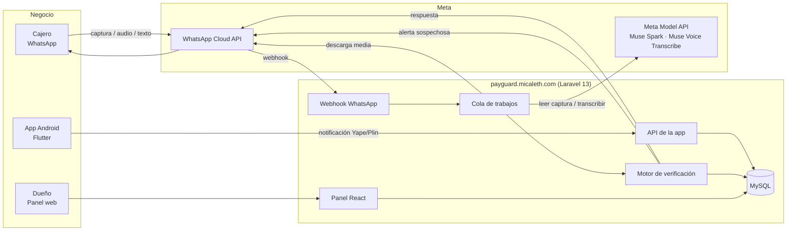

# PayGuard — Arquitectura

## Vista general



## Flujo de una consulta

1. WhatsApp envía el mensaje al **webhook** (`POST /webhooks/whatsapp`).
2. El webhook **verifica la firma** (`X-Hub-Signature-256`), ignora mensajes repetidos (`wa_message_id`), crea la verificación en `processing` y **responde 200 de inmediato**. Todo lo pesado va a la cola.
3. El trabajo en cola:
   - Identifica al cajero por su número. Si no está autorizado, responde que no está registrado y termina.
   - Descarga la imagen o el audio desde WhatsApp y lo guarda en `storage` privado.
   - **Audio:** Muse Voice Transcribe → texto.
   - **Imagen:** Muse Spark lee la captura y devuelve JSON con esquema fijo.
   - **Texto o audio transcrito:** Muse Spark extrae billetera, monto y nombre de la consulta.
   - El **motor de verificación** compara con los pagos recibidos y decide el resultado.
   - Muse Spark redacta una respuesta corta en español a partir del resultado y el motivo.
   - Se envía la respuesta al cajero y, si es sospechoso, la alerta al dueño.
4. Si queda `pending`, el propio trabajo se vuelve a despachar con espera de 20 segundos hasta `recheck_until` y avisa el resultado final. Aparte, el scheduler cierra cada hora las verificaciones atascadas en `processing`.

## Rutas principales

| Ruta | Uso | Protección |
|---|---|---|
| `GET /webhooks/whatsapp` | Verificación del webhook por Meta | Token de verificación |
| `POST /webhooks/whatsapp` | Mensajes entrantes | Firma de Meta |
| `POST /api/device/login` | La app inicia sesión y registra el dispositivo | Credenciales del dueño + límite de intentos |
| `POST /api/device/payments` | La app envía una notificación (idempotente) | Token Sanctum del dispositivo |
| `GET /api/device/payments` | La app lista sus pagos recientes (límite 50) + contador de hoy | Token Sanctum del dispositivo |
| `POST /api/device/heartbeat` | La app avisa que sigue activa | Token Sanctum |
| `POST /api/device/logout` | La app cierra sesión y revoca su token | Token Sanctum |
| `POST /api/panel/register` | Registro del dueño: crea negocio y usuario juntos | Pública |
| `POST /api/panel/login` | Inicio de sesión del dueño | Pública |
| `POST /api/panel/logout`, `GET /api/panel/user` | Cierre de sesión y usuario actual | Sesión (Sanctum, mismo dominio) |
| `/api/panel/cashiers` | Cajeros: listar, crear, editar, activar/desactivar, eliminar | Sesión (Sanctum, mismo dominio) |
| `GET /api/panel/received-payments` | Pagos recibidos: listar con filtro por fecha | Sesión (Sanctum, mismo dominio) |
| `GET /api/panel/devices`, `POST .../unlink` | Dispositivos: listar y desvincular (revoca tokens) | Sesión (Sanctum, mismo dominio) |
| `/` y `/app/*` | Panel web: una vista Blade que monta React con react-router | Sesión (sin sesión redirige a iniciar sesión) |

## Estructura del repositorio

```
payguard/
├── app/
│   ├── Http/Controllers/        # Controladores delgados
│   ├── Jobs/                    # ProcessIncomingMessage, AnalyzeScreenshotVerification, RecheckPendingVerification
│   ├── Console/Commands/        # ExpireStuckVerifications, SimulatePayment, ReparsePayments
│   ├── Services/
│   │   ├── Meta/                # MetaModelClient, ScreenshotReader, ScreenshotData
│   │   ├── WhatsApp/            # WhatsAppClient, SignatureVerifier, MediaStore, OwnerAlerter
│   │   ├── Device/              # DeviceAuthService
│   │   ├── Payments/            # NotificationParser, YapeNotificationParser, ReceivedPaymentService
│   │   ├── Verification/        # VerificationService, PaymentMatcher, DuplicateChecker, CashierReplies
│   │   └── Support/             # Amounts
│   └── Models/
├── config/payguard.php          # Valores configurables (ventanas, modelos)
├── database/migrations/
├── resources/js/                # Panel React + Tailwind
├── routes/                      # web.php, api.php
├── mobile/                      # App Flutter (Android)
├── docs/                        # PRD, plan, base de datos, arquitectura
├── tests/
├── AGENTS.md                    # Reglas para Muse Code
└── README.md                    # En inglés, para los jueces
```

## Configuración (.env, nunca en el repo)

```
META_MODEL_API_KEY=
META_MODEL_BASE_URL=https://api.meta.ai/v1
META_MODEL_VISION=muse-spark-1.3
META_MODEL_TRANSCRIBE=muse-voice-transcribe-1.0

WHATSAPP_TOKEN=
WHATSAPP_PHONE_NUMBER_ID=
WHATSAPP_APP_SECRET=
WHATSAPP_VERIFY_TOKEN=
WHATSAPP_ALERT_TEMPLATE=
```

## Servidor

- VPS Ubuntu 24.04 (el mismo de micaleth), Nginx, PHP 8.3-FPM, MySQL 8, Supervisor.
- Sitio propio: carpeta `/var/www/payguard`, base de datos y usuario MySQL propios, worker de cola propio en Supervisor (`payguard-worker`), cron del scheduler.
- HTTPS con Let's Encrypt.
- No se toca nada de micaleth, mitaller ni mimarket.
