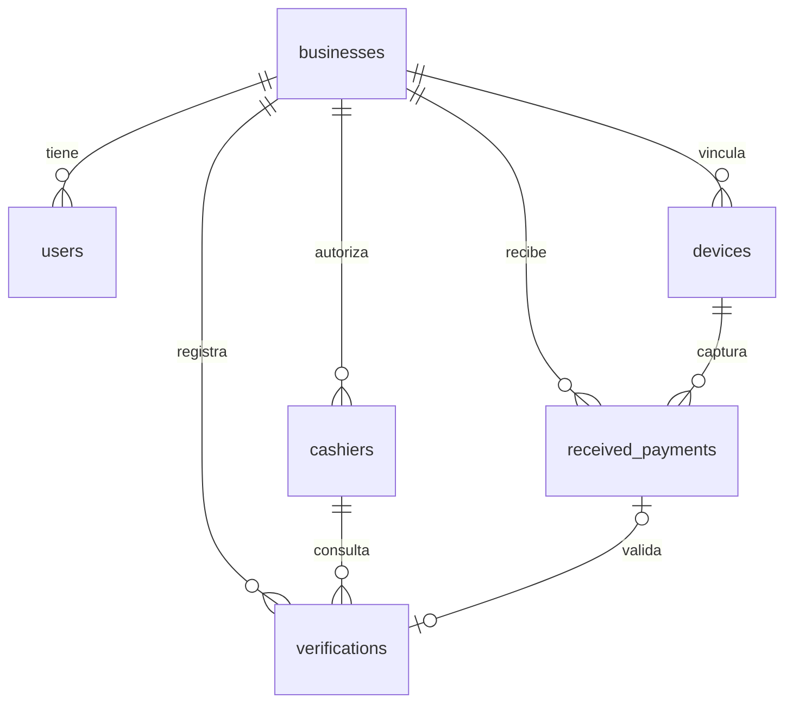

# PayGuard — Base de datos (MySQL 8)

Convenciones: tablas y columnas en inglés y `snake_case`; montos en `DECIMAL(10,2)`; fechas guardadas en UTC y mostradas en la zona del negocio; cada tabla de negocio tiene `business_id` para que un negocio nunca vea datos de otro.

## Diagrama

## Tablas

### businesses — el negocio
| Columna | Tipo | Notas |
|---|---|---|
| id | bigint PK | |
| name | varchar(120) | |
| owner_whatsapp | varchar(20) | Número del dueño para alertas, formato internacional (+51...) |
| match_window_minutes | smallint | Ventana de comparación, por defecto 10 |
| recheck_minutes | smallint | Tiempo de nueva revisión si "aún no llega", por defecto 2 |
| timezone | varchar(40) | Por defecto `America/Lima` |
| timestamps | | |

### users — el dueño (inicia sesión en el panel y en la app)
| Columna | Tipo | Notas |
|---|---|---|
| id | bigint PK | |
| business_id | FK businesses | |
| name, email (único), password | | |
| timestamps | | |

### cashiers — cajeros autorizados (no inician sesión)
| Columna | Tipo | Notas |
|---|---|---|
| id | bigint PK | |
| business_id | FK businesses | |
| name | varchar(80) | |
| whatsapp | varchar(20) | **Único en todo el sistema**: así PayGuard sabe de qué negocio es cada consulta |
| is_active | boolean | |
| timestamps | | |

### devices — celular con la app que captura los pagos
| Columna | Tipo | Notas |
|---|---|---|
| id | bigint PK | |
| business_id | FK businesses | |
| name | varchar(80) | Ej.: "Celular de caja" |
| last_seen_at | datetime null | Último contacto de la app |
| last_payment_at | datetime null | Última notificación enviada |
| timestamps | | |
La app se autentica con token de Sanctum ligado al dispositivo.

### received_payments — notificaciones reales de Yape/Plin
| Columna | Tipo | Notas |
|---|---|---|
| id | bigint PK | |
| business_id | FK businesses | |
| device_id | FK devices | |
| wallet | enum(`yape`,`plin`) | |
| amount | decimal(10,2) null | null si no se pudo leer |
| payer_name | varchar(120) null | |
| received_at | datetime | Hora de la notificación en el celular |
| raw_text | text | Texto original, siempre se guarda |
| parsed | boolean | Si las reglas lograron leerlo |
| idempotency_key | varchar(64) **único** | Evita guardar dos veces la misma notificación (reintentos de la app) |
| timestamps | | |
Índice: `(business_id, amount, received_at)` para la búsqueda rápida.

### verifications — cada consulta del cajero
| Columna | Tipo | Notas |
|---|---|---|
| id | bigint PK | |
| business_id | FK businesses | |
| cashier_id | FK cashiers | |
| wa_message_id | varchar(100) **único** | Evita procesar dos veces el mismo mensaje de WhatsApp |
| input_type | enum(`image`,`audio`,`text`) | |
| media_path | varchar(255) null | Archivo guardado en `storage` (privado) |
| media_sha256 | char(64) null | Detecta la misma captura reenviada |
| transcript | text null | Texto de la nota de voz |
| extracted | json null | Datos leídos por Muse Spark |
| wallet, amount, payer_name, paid_at, operation_code | | Copia de los datos clave para buscar y mostrar |
| edit_signals | json null | Señales de posible edición detectadas |
| status | enum(`processing`,`pending`,`verified`,`not_found`,`mismatch`,`reused`,`error`) | |
| reason | varchar(255) null | Motivo en español, el mismo que se responde |
| received_payment_id | FK received_payments null, **único** | Una notificación real valida una sola captura |
| recheck_until | datetime null | Hasta cuándo seguir buscando si está `pending` |
| ai_ms | int null | Tiempo de respuesta de la IA |
| timestamps | | |

### Tablas propias de Laravel
`sessions`, `cache`, `jobs`, `failed_jobs`, `personal_access_tokens`, `password_reset_tokens`.

## Reglas de verificación (resumen)

1. Buscar en `received_payments` del mismo negocio: misma billetera, **mismo monto**, `received_at` dentro de ±`match_window_minutes` de `paid_at`, y **sin** verificación asociada.
2. Si hay varias, elegir la de nombre más parecido y hora más cercana.
3. Si la imagen (`media_sha256`) o el número de operación ya se usaron en una verificación aprobada → `reused`.
4. Si no hay coincidencia todavía y la captura es reciente → `pending` y volver a buscar hasta `recheck_until`.
5. Si hay un pago parecido pero el monto o el nombre no cuadran → `mismatch` con el motivo.
6. Las señales de edición de la IA se informan en el motivo y suben la alerta, pero **el resultado lo decide la comparación con el pago real**.
